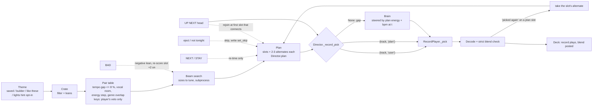

# The night as a plan: the set planner in the app

*2026-10-28. Written after "we just have a decent automixer" and an evening with the prototype planner
(scratchpad `set_planner_proto.py` + `theme_builder.template.html`). You asked for the planner in the app,
the one-pager first. Nothing here is built until you say yes. Companions: DJ_MIXING.md (how two records
blend, unchanged here), DJ_THE_SET.md (the layered engine's chain, whose rules this copies).*

## 1. What changes for you

Today the record player looks one song ahead. `RecordPlayer._pick` asks the brain for
`choose_next(current, 0.6, bpm)` (recordplay.py:411): the same energy all night, no tempo target. The
arc, length and energy dials don't reach it ("Nothing else applies in RECORD mode", director.py:460).
That is why it sounds like an automixer: every pick is a good next record, and nothing makes the night go
anywhere.

With the planner, **before the first record you pick a theme, and the night is planned end to end**: an
ordered list of records in chapters ("Doors", "Dusk", "Peak", ...), each with the energy and tempo its
chapter asks for at that point, and each pair checked to blend. You see that list and can steer it. The player
follows it record by record.

What stays exactly as it is:

- **The cut is yours.** The plan never touches the record that is playing or a blend that has already been
  decided. A re-plan changes only records further down the list. The player still posts its own blend
  (DJ_MIXING.md rules: phrase-aligned, one bass, never two singers). The plan adds no cuts. The player's
  existing play-to-end fallbacks (no phrase of the record left, a tempo gap over 8 %) stay, and are counted.
- **NEXT, STAY, BAD, UP NEXT, eject** do what they do today. The plan follows what they did (section 3).
- **The brain** stays as the night's memory and the gap-filler. It stops deciding the night.

```
 energy                                   the night as planned (one picture, both surfaces)
  1.0 |                           ____
      |                     _____/    \___
  0.5 |     ______    _____/              \______
      | ___/      \__/                           \___
  0.0 +------+-----------+-------------+--------------+---> time
        Doors    Dusk        Rise          Peak        Afterglow
        [o][o][o][o][o][*][.][.][.][.][.][.][.][.][.][.][.][.]
         played     now    planned (hollow), each with 2-3 alternates
```

> **You are deciding:** yes or no to the plan model (sections 1-3), plus four choices (section 8, my pick first):
> 1. A planned record that can't be placed: **play its alternate**, or keep it with the relaxed blend.
> 2. Keys until the rescan: **the planner obeys the player's key veto, pass/fail only**, or both sides relax.
> 3. After your UP NEXT: **rejoin the plan**, or re-plan the rest from your record.
> 4. The builder: ~~the planner app serves it to your browser~~, a Qt port, or an embedded browser. **Decided
>    2026-10-29: in the app, the Director tab's NIGHT tab; the browser builder is dropped** (section 8).

## 2. A theme, and how you pick one

A theme is the prototype's object, unchanged:

| Part | What it is |
|---|---|
| **Crate** | Which records may play at all: source (library or a playlist), genres to require or exclude, moods (any of), tags to require or exclude, **your folders and setlists (any of, 2026-10-30: `groupsIn`)**, tempo range, energy range, vocals (any / none / some / lots). Genres read Beatport's compound names whole ("organic house / downtempo", section 2a). |
| **Leans** | Weighted words that make a record a better fit (e.g. `downtempo 1.0, warm 0.6`). The crate filters records out; leans rank the ones that are left. |
| **Story** | Chapters: a name, a share of the night, an energy course (from, to), a tempo course (as crate percentiles), and optional courses for mood, vocals, hypnotic, hardness, **mode** (minor 0 → major 1) and **percussive** (melodic 0 → percussive 1) (the last two 2026-10-30, section 2a), plus chapter leans. |
| **Keys** | veto / close / wander / lift (`keys_mode`). The keys were rescanned 2026-10-28 (key v2, 0.825 exact against Beatport), so the modes now score: a light factor on each seam in the planner's search, never a veto of its own. **veto** is the default and today's planner exactly; it is the only mode of a theme that does not set `keys_mode` (the presets' stored `keys` words are not read, so they plan as before until you pick a mode). **close** prefers Camelot distance 1 or less over the diagonal the veto still lets through; **wander** has no preference beyond the veto; **lift** prefers the +1 move on the wheel where a chapter's energy rises (+2 fits 0.55, under the player's veto, so it never blends). The player's veto (`KEY_BLEND`) stands in every mode. |
| **Variety** | Night seed, rest for records played in the last 30 days, artist spacing. Seed 1 has no noise; every other seed scales each record's fit by 1 ± 0.25 and each seam's by 1 ± 0.15, so BUILD (a new seed) plans another night (section 2a). |
| **Length** | Minutes. This becomes the LENGTH dial in record mode. |

Four ways to fill one, all producing the same object:

1. **Saved themes**: the presets (the builder's six plus the eleven of 2026-10-30, section 2a; `setplanner.PRESETS`, in code and never deleted) and the
   ones you saved (the library DB's `themes` table, schema v17, with their seed and length). You pick one from a
   list, and it applies on pick. (The brain's nine `PICKER_THEMES` are the "no plan, the DJ picks" choices.)
2. **The NIGHT tab** (decision 4, 2026-10-29): the crate / leans / chapters / keys editor, in the planner app's
   Director tab. It replaces the browser builder.
3. **By example, "a night like these"**: select 2 to 5 records and the theme is inferred from them. The crate
   is each measure's range across the examples plus a margin (tempo ±4 %, ranks ±0.10), widened until it holds
   about twice what the night needs, and every widening is shown. Leans are weighted by *lift over the
   library*: "sexy" is on 77 % of records and "deep" on 70 %, so those words count for almost nothing. Vocals
   come from the stems' vocal envelope (`.stems/<id>/env.npz`, the player's -24 dB test), not from `axes.vc`,
   which the prototype uses and which read 0.0 on two records that sang. The examples' energy spread suggests the story: a
   narrow spread gives one flat chapter, a wide one gives a rise from the lowest example to the highest. The
   example ids are stored with the theme and the theme is re-inferred on load, because every rank is relative
   to the library it was measured in (unless you edited it after the inference: then your edits are the theme).
   Built 2026-10-29 as `lib/dj/themestore.infer`, run in the planner's process (`op: "infer"`).
   **The planner judges (2026-10-30).** The crate's count toward its target leaves out what the night cannot
   play (played tonight, not tonight, the decks' records); the examples are often records played tonight. The
   count is not the whole test, though. "Like Galapagos +2" during a night inferred 49 records (45 playable,
   target 44), but from slot +1 (Waves) only 5 pairs led into the crate. Three were the playing record and two
   examples already played. The other two were a dead end (Gathering of the Tribes, whose only pair was Waves)
   and Aberrations in Blindness. The one record after that was Polo & Pan again, inside the artist spacing of
   Dorothy, which had played. So the plan held 1 record and ran out at 0:13. Now an *unedited* inferred theme
   whose plan does not reach its length is widened one more rung of the same ladder (`themestore.widen`,
   `inferred.ladder`) and planned again in the same request. This repeats until the plan finishes, the ladder
   runs out or `WIDEN_BUDGET_S` (4 s) is spent. That night: 3 rungs, 49 → 99 records, 18 planned, 4 plans in
   0.08 s. The answer carries `widened` and `theme_used`. The NightPlan keeps that crate and ladder, so later
   re-plans start from it, and the NIGHT tab and the web page show it. An edited theme or a preset is never
   widened: its warning says how to fix it.
4. **A playlist** is a crate source, as it is in the builder. A playlist is still a pool and never a planned night
   (section 5 keeps the two apart).

### 2a. The seventeen presets, finer words, two more story controls (2026-10-30)

Built from the user's picks on the category survey (scratchpad `cats/`: what the library's records carry, which
measures can steer a chapter, 15 drafted themes planned through the real planner).

**Eleven new presets** after the builder's six, each tuned until it plans finished at 90 and 180 min, seeds 1-3, with
no red chapter (seed 1 has no noise, so it is the "same" night the gates plan):

| Preset | Crate | Pairs / record | Records 90 / 180 min | Thin slots (max) | Note |
|---|---|---|---|---|---|
| Melodic Journey | 236 | 50 | 18 / 38-39 | 0 % | Summit asks for melodic records (percussive 0.35 → 0.30) |
| After Hours | 426 | 78 | 20-21 / 38 | 0 % | minor keys through the night (mode 0.1-0.25), Daylight turns major-ish |
| Hypnotic | 290 | 66 | 18-19 / 38-39 | 0 % | drafted as "Minimal Loop"; the library holds one minimal record, so it is named for what it plays |
| Afro Sunset | 149 | 21 | 18 / 34-35 | 0 % | Hand drums percussive (0.7 → 0.8); see below for Embers |
| Warm-up | 286 | 25 | 20-21 / 41-42 | 10 % | Settling eased to 0.30 → 0.42 (it went red in 3 of 4 survey runs) |
| Vocal Night | 337 | 34 | 20-21 / 39-41 | 0 % | crate vocals "lots" |
| Sunrise | 468 | 33 | 21-23 / 41-42 | 10 % | Birdsong's tempo course 0.30 → 0.15 (0.25 → 0.05 left 20 % thin: the slow end of the crate blends little) |
| Instrumental | 472 | 57 | 21 / 41-45 | 2 % | the tuned form: crate vocals "some" plus a vocals course 0-0.05 in every chapter |
| Peak Time | 354 | 68 | 20-21 / 39-41 | 0 % | an energy night; its leans promise no techno (the library holds 28 techno records): it plays as high-energy prog and melodic techno |
| Deep Lounge | 174 | 25 | 19-21 / 39-40 | 5 % | the user wanted it anyway: plays as warm house and organic house (28 deep house records) |
| Trance Uplift | 112 | 20 | 18 / 36-38 | 8 % | the user wanted it anyway: plays as progressive house (the 28 trance / psy records sit at 125-142 bpm, median 134, past a blend's tempo reach from the prog that fills it); its peak chapter is "Peak", not "Psy peak" |

Afro Sunset at 180 min had a red Embers in 3 of 3 runs: the crate's middle energies were used up before it (Hand drums
took 0.5-0.65 for 54 minutes), so Embers placed 0.74-0.89 records where it asked for 0.4-0.5. Hand drums now sits at
0.55 → 0.68 and Embers ends at 0.50 (tempo 0.6 → 0.5): no red in any run, Embers amber in 2 of 3 at 180 min. The six
builder presets kept their crates (the same records, checked by the unit gate) and their seed-1 nights except where
the chapter words below changed; Slow Morning stays thin (13 pairs per record, 24-59 % of slots with under 2
alternates, said by its warning: its crate is the user's).

**Chapter words that occur (task 5).** Falling chapters leaned on ML mood words that almost never sit on records near
their energy: "emotional" on 0-8 % of the eligible crate records, "hopeful" 0-8 %, "inspiring" 9 % (Prog Odyssey's "The
way down" missed on 27 of 33 placed records). Every preset chapter was measured (`cats/leans_near.py`: crate records
within the chapter's energy ± 0.08, the warning's own window), and a lean under about 10 % was replaced by a word that
sits there and fits the chapter: The way down "dream, mellow, warm", Night Shift's Surface "melodic, warm, space",
Golden Hour's genre leans that its crate barely holds (deep house 5 %, nu disco 2 %, indie dance 5 %) by "mellow",
"retro", "danceable", and so on (setplanner.PRESETS). Records placed with none of their chapter's leans, 17 presets
× 90 / 180 min × seeds 1-3: **424 of 3005 → 206 of 2996**; The way down 27/33 → 3/37, Surface 15/23 → 1/26, Warm-up's
Settling 26/62 → 5/68, Deep Lounge's Groove 26/74 → 3/71, Instrumental's Pulse 28/48 → 7/50.

**Beatport's genre names whole.** The library's parser splits a file genre on "/": the 64 club tracks tagged "Organic
House / Downtempo" read as "downtempo", and "Techno (Peak Time / Driving)" as "techno (peak time" and "driving)". The
planner and the NIGHT tab's vocabulary now read genres through `setplanner.genre_words` / `record_words` (read time
only; the DB, the scanner and the brain's own `genre_set` are untouched): a piece with " / " in it is one word, plus the
family words that really describe the record (`GENRE_FAMILY`: Organic House / Downtempo is "organic house", never
"downtempo"; Nu Disco / Disco is both; Techno (Peak Time / Driving) is "techno"). Night Shift's lean and Slow Morning's
exclusion say "techno (peak time / driving)". The six builder presets' crates hold exactly the records they held.

**Your categories as crate words.** Your top music folders (Desert Whomp, Groovy, Loungey, Melodic Techno 2025, Swamp
Womp, ...) and your setlists (Prog House, Poopy, Cyber, ...) are a crate filter, `crate.groupsIn` (any of; a folder
and a setlist of the same name are one word), shown in CRATE as the "yours" chips; the crate op counts them
(`groups`). Every record also carries "@name" for each (the leans can use it; "@groovy" never collides with the mood
"groovy"). "Like these" weighs "@name" by lift like any word, so a folder becomes a lean only when it is informative;
it never narrows the crate.

**Two more story controls** (`CH_DIMS`, scored like mood / vocals / hypnotic / hardness; STORY's "courses…" editor):
- **mode**, minor 0 → major 1, from key v2's mode (`tracks.key_mode`, 88 % right on the truth set; 627 minor, 446
  major). A confident reading is 0 or 1; an unsure one (key_conf under 0.5) sits toward 0.5 (0.25 / 0.75 at none). Being
  two-valued it scores with a wider width (0.5): a course at 0 asks for minor, 0.5 for either.
- **percussive**, melodic 0 → percussive 1: the drums' share of drums + other in the stems' body power (env.npz "rms",
  the file the vocals measure already reads), ranked across the library. 1045 of 1073 records (97 %).
Cost: both are read while the planner loads the library (the rms array is read from the env.npz already open for the
vocals), under 0.15 s of a 5 s load; no cache was needed. The unit gate checks that a chapter asking for minor plans
more minor records than one asking for major (and the same for percussive). "Like these" proposes them when the
examples agree: every example minor (or every one major) gives a mode course at their mean, percussive ranks within
0.25 a percussive course.

**BUILD must change the night.** The builder's night noise (each record's fit × 0.86-1.14, the same all night; seed 1
none) left 8 of 102 seed pairs (17 themes, 90 / 180 min, seeds 1-3) planning the very same night. A record-only factor
cannot break a strong chain (Desert Night's 1046 → 408 → 136 → 99 → ..., every seam "neither sings, the drop on the
swap") and ± 0.25 still left 3 of 221. Now every seed but 1: each record × 1 ± 0.25 (`NOISE`), each seam × 1 ± 0.15 (a
hash of the pair, `PAIR_NOISE`), and the seed picks among the finished nights within 0.05 per record of the best
(`TIE`; Warm-up's 90 min chain survived the noise alone). The rules are untouched: every candidate still passed the key
veto, the vocal room and the strict placement before it was scored. **0 of 102 seed pairs plan the same night**
(before: 8); chapter warnings over those 102 plans amber 44 → 24, red 31 → 0 (the tuning above included); the same
seed plans the same night.

**The lighting set as a helper: opt-in, off by default, lives in the project.** A new hook in
`projects/fan/project.yaml` (`dj_music: projects.fan.dj_music`) maps a weather set to a theme
(`SET_MUSIC = {"ocean": {"theme": "Deep Water", "why": ...}}`). The engine has one generic loader shaped
like `load_project_panels`. A project without the hook shows no toggle. When the toggle is on, a set change
*offers* that set's theme on the DJ page ("Ocean suggests Deep Water"), and your own pick always wins. It
reads only *which set* is on, never the current weather state or room, because `club_director` picks rooms
from the DJ's audio energy (club_director.py:670) and that loop would run away.

Only this lights-to-music mapping is project content. The planner and themes are DJ-subsystem content,
library-wide like the rest of `lib/dj`, so they live there.

## 3. How the player follows the plan, and how each button re-routes it



**The plan lives in the Director** as `self.plan`, next to `self.horizon` (director.py:254), with
`horizon`'s rule 2: *a slot changes only when it becomes impossible or you change something*. A GOOD
never re-plans.

**A re-plan is too heavy for a thread in the show.** The browser builder's search (60 beams x 12, JavaScript)
takes about 0.5 s for 90 minutes. The Python prototype (70 x 14, a 320-record crate) took 1.9 to 12 s for
90 minutes and 4.8 to 16 s for 180 minutes, not counting the pair table (sets.json, 2026-10-27). A 6 h
night is unmeasured, estimated at up to about 30 s. A thread would hold the GIL that long, and 85-119 ms
stalls already hurt. So the pair table and the search run in a **subprocess**: the pair table is built once
at START, and the show only receives slot lists. Because slot +1 is fixed and a record lasts minutes, a
re-plan has minutes to finish.

**Which records are fixed.** The player commits the next record as soon as a record opens: it decodes it
right away (recordplay.py:534) and decides the blend once it is ready (568). So the **playing record
and the next one (slot +1) are fixed**, and every re-route below changes slot +2 onward. That is also why
a re-plan can never cause a cut.

**Three fixes to the hook, required before any of this works.**
- Today every record the hook returns joins `_user_ids` (recordplay.py:379), which skips the blend
  re-pick (446). Fed through it unchanged, every planned record would count as one *you* asked for. Every
  awkward pair would then get the relaxed outro-only blend, or a play-to-the-end cut across a tempo gap
  over 8 % (842). The hook returns `(track, 'user' | 'plan')`, and only your records skip the re-pick.
- The hook path does not check `_unfit` or avoid_ids (376). The plan skips both.
  `_unfit` is cleared at each swap, so one bad pair stops banning a record for the whole night
  (180, 384).
- The player probes a pick only while `_repicks < 2` (446), and resets the count only at a swap (601, 1146).
  A third pick is taken unprobed and gets the relaxed outro blend, which is the automixer again. So the
  Director checks each candidate's pair facts (tempo, key veto, vocal room) against the record playing
  before offering it, and most refusals never reach a decode. Plan picks also get their own budget of
  3 probes, one per alternate. The gate counts relaxed blends on plan picks; the target is 0.

| Event | What plays | What happens to the rest of the plan |
|---|---|---|
| **NEXT** | Slot +1 comes in now (short blend; a cut only on a key clash or a tempo gap over 8 %, recordplay.py:833-841, which is yours because you pressed it). | Order stands. Times move earlier, re-anchored on the player's own clock (`cut.swap_in_s`, `end_in_s`). A re-search happens only if a chapter boundary moves by more than a slot. |
| **STAY** | The blend moves a phrase later, never earlier (recordplay.py:1278). | Order stands, times move later. If STAYs push the night past its length, the lowest-value slot near the end is dropped. A record is never shortened. |
| **BAD** | As today: `_learn_song` + `player.bad()`. Slot +1 comes in. | The record's tags become a negative lean, and slots +2 onward are re-scored off-thread. Slots that still fit and don't carry those tags stay. |
| **Your UP NEXT** | Your record goes first, with the relaxed blend (it is yours). | The plan rejoins at the earliest remaining slot that connects from your record, keeping the chapter clock. Skipped slots are marked "skipped for your record". If no slot connects, the rest is re-searched from your record (decision 3). |
| **A planned record the rules can't place** (strict blend refused: span, two singers) | The slot's next pre-checked alternate, within the plan's own probe budget; then the brain. | Slots +2 onward are re-searched from what plays. The THEN row says "picked again: X could not blend after Y, Z instead". |
| **Eject / not tonight** | As today. | The id joins the plan's skips and a `set_skip` row is logged. Without that, the hook hands the same record straight back (director.py:1923 records nothing today). |
| **"cannot be the record"** (recordplay.py:381) | The DJ picks. | The plan pops that slot, as `_feed_up_next` does for UP NEXT (director.py:2562). Otherwise the plan stalls while the brain silently fills every slot. |
| **Plan used up** (NEXT-heavy night) | A re-search appends records in the last chapter's character. Only when the crate has nothing left does the brain carry on (its energy and bpm, the crate as `pool_ids`), each pick shown as "the DJ filled a gap". | - |
| **Turn LENGTH / ENERGY / the arc** | Nothing changes for the playing record or slot +1. | The rest is re-planned. These dials stop being dead in record mode. |

**The planner's clock must be the player's clock.** The prototype credits each record from its landmark to
its end (set_planner_proto.py:145). The player blends out at the first phrase at or after max(the minimum
play, 0.6 of the record) (recordplay.py:752, `LAST_FROM`). A "90-minute" prototype plan therefore plays
noticeably shorter, and its chapters arrive early. The in-app planner uses the player's geometry and
re-anchors on every real swap.

**The lights get the night too.** Record mode publishes `dj_arc_phase = 0.0` today (Stories_OGL.py:3026), and
`club_director` follows it, so the club's lights sit at "Doors" all night (club_director.py:709). With a
plan it publishes real progress (elapsed / length) and the chapter's energy as `dj_arc_heat`. Without a plan
it drops `dj_arc_phase` only, which club_director already reads as "no lean", and keeps `dj_arc_heat` a
number (0.5), because a None heat once killed the render loop (Stories_OGL.py:3023). This no-plan fix can
ship on its own, ahead of the planner.

## 4. Where it appears

**Planner app, Director tab: where you plan, shape and play the night** (built 2026-10-29; the user's layout,
after "the dj planner director panel does not really [have] the options we've been working towards"). Applies on
pick everywhere; before START the whole night is planned, during it the rest from slot +2 (the record playing and
slot +1 never change, so nothing here can cause a cut).

- **One picker** in place of the brain's theme box and the night box: the planned nights first (the presets, then
  your saved themes, ★; right-click a saved one to delete it), then "no plan, the DJ picks: <the brain's theme>",
  which is today's behaviour exactly; it opens with every entry in view (17 presets, your themes, the DJ's 9; each
  preset's blurb in its tooltip). Beside it **LENGTH** (45 / 60 / 90 / 120 / 180 / 240 / 360 min, default 90),
  **BUILD** (the same theme, a new seed - another night where the crate allows it, section 2a; lit until the new night
  is planned) and **SAVE** (asks for a name, default
  "<theme> (mine)"; the seed and the length are saved with it, so it plans the same night again).
- **The NIGHT tab**, first in the right column in RECORD mode, in place of DIALS (the other LAYERS modes keep DIALS
  as before). Every edit is made in place and applies on its own, debounced 600 ms; an edited preset shows as
  "<name> (edited)" until it is saved. CRATE: genres in / out and tags in / out as small chips (a click cycles in,
  out, off; right-click = out), moods (any of), "yours" (your folders and setlists, any of; 2026-10-30), the tempo and energy ranges as paired boxes, vocals any / none /
  some / lots, and the live count ("743 records · about 71 blendable pairs each", from the planner's own pair
  table, `op: "crate"`). LEANS: a word and a weight slider (0 to 2), add / remove. STORY: the chapters as rows -
  name, share (renormalised), energy from→to, tempo from→to, chapter leans, the optional courses (mood / vocals /
  hypnotic / hardness / mode / percussive) - add, remove, reorder. Under them the dials that act in RECORD mode (LAYERS, which switches
  engines, PACE, ENERGY, BASS, TONE, LEVEL; ARC is left out, the chapters are the arc), the KEYS row, and the
  moments. The planner's warnings sit in the header as short words, amber or red, the sentence in the tooltip.
  With no plan the tab shows MOOD instead of the editor.
- **The night strip.** With a plan, the arc strip draws the chapters as bands with their names, each record as a
  block at its energy (solid played, hollow ahead), the chapter's energy course, the playhead, and amber / red marks
  on a chapter that misses (red only when more than half its records miss). A block's tooltip names the record, its
  chapter, its time, the energy it has against what the chapter asks, the leans it matched and how it comes in.
  (2026-10-29 fixes) A chapter is marked only when at least 2 of its records AND at least a third of it miss (one
  record a little off is the search's normal give); the word reads "Dusk 2/5 off", the tooltip names the records, and
  the strip outlines each record that misses. Six presets at 90 min, seeds 1-5: 39 of 115 chapters were marked by
  the any-record rule, 14 now (5 red either way). The strip is 116 px tall; while a re-plan runs it keeps the last
  plan, dimmed, "planning…" (a new pick shows its chapters before any record is placed) - it never falls back to the
  arc while a night is wanted, and it ignores clicks then (no arc jump or bend). Hovering the name row / the mark at
  the top of a band shows the chapter; a record answers only near its block. In RECORD mode the four lanes below are
  thin (16 px: the record's stems and the planned seam). A planned night's ARC is always "theme" (a hidden ARC, a
  strip drag before the pick, the controller's ARC knob cannot rewrite the STORY); the controller's LENGTH knob goes
  through the LENGTH box. CRATE has its source ("from": the library or a playlist); the songs box only feeds the DJ's
  gap picks in a planned night. With ENERGY on cool / amp each STORY row shows the course the plan really asks.
- **"A night like these"**: select 1 to 5 records in SONGS (Ctrl / Shift + click) and press ≈ LIKE THESE, or
  right-click them. The inferred theme shows as "<name> (unsaved)", with every widening of its crate listed.
- THE PLAN keeps its THEN rows after UP NEXT; right-click one for UP NEXT · not tonight · its parts.

```
 [▶ START] [Desert Night ▾] [90 min ▾] [BUILD] [SAVE]  [OUTPUTS] [songs ▾]
 NIGHT Desert Night · 0:31 of 1:30 · Caravan · seed 41
 ┌ Dusk ─────┬ Caravan ───────┬ Sandstorm ──────▲┬ Starfield ┐   ▲ amber / red: a chapter that misses
 │ ▬ ▬ ▬     │ ▬ ▬ ▭ ▭        │ ▭ ▭ ▭ ▭ ▭       │ ▭ ▭ ▭     │   ▬ played, ▭ ahead, at its energy
 └───────────┴───┼────────────┴─────────────────┴───────────┘
 NIGHT | PARTS | PLAN | PAIRS | MASHUP
  743 records · about 71 blendable pairs each        [thin crate] [Sandstorm misses]
  [CRATE] [LEANS] [STORY]
  tempo [80.0]–[135.0] bpm   energy [0]–[100]     vocals [any][none][some][lots]
  genres  [electronic][downtempo][~~rock~~][~~pop~~][organic house] …  [+61]
  LAYERS [record][one]…   PACE [short][normal][long]   ENERGY …   BASS …   TONE …   LEVEL …
  KEYS [veto][close][wander][lift]
  [NEXT SONG] [STAY]  [DROP] …  [GOOD] [BAD] …
```

(The app does not see code changes: after a build, restart it.) Not built: the Set tab's planned sets and PUSH TO
LIVE, the Library tab's "like these", and the THEN row's "alternates ▸ / like these" entries.

```
 THE PLAN
  NOW    Lantern · Dusk                       blend at 4:12 (32 bars)
  NEXT   Moonwake · Dusk                      decoded
  THEN   0:31  Antrea · Rise · +2 % · 0.55
  THEN   0:37  Kora · Rise · picked again: Sultans could not blend after Antrea
  THEN   0:42  (skipped for your record) Halo
```

**Web /dj page (phone).** Theme chips above SONGS light when pressed and apply on pick. The hidden arc canvas
`dj-dr-arc` (hidden in record mode, dj_panel.html:1394) becomes the night strip: chapter bands, records
as blocks at their energy, the playhead, and amber or red marks on a chapter, with the warning in the tooltip
(red only when more than half of a chapter's records miss). Re-route notes go into the story lines. "More
like these" goes on Tonight's history rows. The theme editor (the NIGHT tab) is desktop-shaped and stays off the
phone card.

(Built 2026-10-29, the user's "what about in the DJ page?") The presets as night buttons with a LENGTH select (with 17
presets since 2026-10-30 the row wraps to six rows on a phone and two at 1280, unchanged otherwise: its replacement is
being decided), in the
Director card in RECORD mode and under Prepare ("Night ★", armed for ★ DIRECTOR, which plans it before its first
record while the room keeps its sound). The strip is drawn at the screen's density; a chapter mark reads "Orbit 2/5
off" and the records that miss are outlined; while a re-plan runs, or a new pick waits for its first answer, it keeps
the last plan dimmed with "planning…" and taps answer nothing; a record answers only near its block. A failed new
night shows no strip (the error stays on the button and in the story line). The story lines carry two night notes at
most (the rest in the last one's tooltip); "planned · theme" is not one, the lit button says it. The classic DJ's
card is "The DJ's arc", its set length dimmed while a night is armed.

```
 [Sunday drift][Deep Water][Peak hours][+ like these]      ← chips, lit = on
 ▕▔▔Doors▔▔▕▔▔Dusk▔▔▔▕▔▔▔Rise▔▔▔▔▕▔▔▔▔Peak▔▔▔▔▔▕▔After▔▏
   ▂ ▂ ▃    ▃ ▃ ▃ ▲    ▄ ▅ ▅ ▆     ▇ ▇ █ ▇ ▇      ▅ ▃ ▂   ▲ = now
 [lights pick the music]  (only when the project has the hook; off)
```

## 5. Storage

Planned sets are kept apart from playlists, so a planned night never shows up as a SONGS pool. Themes live
in the library DB, which travels with the music folder (the presets stay in code; your builder themes are
imported once). The night survives a restart: every (re)plan is logged, and on start the Director resumes
the latest plan within `NIGHT_HOURS` at its wall-clock chapter. (Resume and schema: phases 2 and 3.)

## 6. What it does not do yet

- **Keys: the rescan is done, and the keys modes now score (2026-10-29).** Before it, 34 % of the library read 7B,
  so keys got no score and no mode, only the player's veto (decision 2). The keys-only rescan (key v2, 2026-10-28)
  reads 0.825 exact against Beatport. Keys still cannot be off on one side only: the player refuses any strict blend
  under `KEY_BLEND` 0.68, so the planner keeps dropping those pairs in every mode, and a mode is only a light factor
  on the seams that are left (section 2's table): veto, the default, is today's planner exactly (verified: the same
  seed plans the same night with no mode in the request), close and lift lean the search, wander leaves it. Lift's
  +2 move fits 0.55, under the veto, so in practice lift prefers +1.
- **No learning, no audio "sounds like", no figures or stems.** BAD steers tonight's remainder through leans
  and nothing is trained. "Like these" is measured from the analysis the library already has. The blend
  between two planned records is DJ_MIXING.md's, as today.

## 7. Build phases, a gate each, smallest useful first

1. **(a) A planned night plays, headless.** The planner in `lib/dj/` as a subprocess (the prototype's search,
   with the player's clock, env.npz vocals and the key veto). `Director.plan`, the three hook fixes, the
   plan's energy and bpm steering the brain's gap picks. A theme from a file or a preset.
   *Gate (`_dj_plan_gate.py`, explicit log_dir):* the planned order matches what played, 100 %. Relaxed blends
   on plan picks: 0 or near it. Zero cuts on plan-to-plan seams, with other cuts reported separately. Each
   chapter arrives within one record of its planned time. Zero audio-producer underruns, and the audio
   callback keeps its margin, during 20 forced re-plans. Re-plan cost measured at 90 min and 6 h.
   **(b) You see it and hear it.** THEN rows in the Director tab, the real `dj_arc_phase`. *Gate:* the THEN
   rows match the plan the subprocess sent. *You hear:* one 90-minute night of one theme, and the chapters are
   audible.
2. **Re-routes and restart.** Section 3's table, plus `set_plan` / `set_skip` rows and resume.
   *Gate:* the control gate presses NEXT, STAY, BAD, UP NEXT, eject and not-tonight at random states. Every
   change to the plan has a trigger, and a change without one is BROKEN. Slot +1 never changes without
   eject. A kill-and-restart mid-chapter resumes in the same chapter with no repeats.
   *You see:* a row that moved says why.
3. **Themes in the app.** The v17 schema (v16 went to `tracks.key_version`, the key v2 rescan; `setlists.kind` playlist/planned + `plan_json`, a `themes` table,
   `list_setlists` callers filter on kind), saved themes, "like these" in the Library and Director tabs, and
   the NIGHT tab (decision 4: in the app, the browser builder dropped). Push to live loads a plan.
   **Partly built 2026-10-29:** schema v17 with the `themes` table only (no `setlists.kind` / `plan_json` yet),
   saved themes, the NIGHT tab, the keys modes, and "like these" in the Director tab's SONGS. Not built: planned
   sets apart from playlists, the Library tab's "like these", push to live.
   *Gate:* five example sets of 3 records each give crates of about twice the night's need, with lifted leans.
   Every widening is shown. *You:* plan a night from records you chose and say if it is that night.
   *The NIGHT tab's own gate:* `tools/tests/_dj_night_tab.py` (headless, no audio; section 9).
4. **The phone page.** Theme chips, the night strip, re-route lines and "more like these", published through
   `dj_info` as delta-hashed keys from the background refresh (no DB reads on the render thread).
   *Gate:* tick under 5 ms; a chip press re-plans and redraws within a second.
5. **Lights pick the music (opt-in).** The `dj_music` hook in projects/fan and the toggle.
   *Gate:* with the toggle off, nothing changes. With it on, a set change offers the theme once, and never
   for a set held under a minute.

## 8. Decisions for you

**Decided 2026-10-28:** the plan model, yes, build phase 1, with the lights fix shipped first on its own.
1. **The alternate.** 2. **Obey the player's key veto.** This was not asked again because the keys-only
rescan runs tonight, and the veto reads whatever keys the DB holds. 3. **Rejoin.** 4. ~~Served to your
browser~~ (phase 3). The defaults below stand.

**Decided 2026-10-29: decision 4 changed to the app.** The theme is edited in the planner app's NIGHT tab (the
Director tab, section 4), and the browser builder is dropped (the user's pick, after "the dj planner director panel
does not really [have] the options we've been working towards").

1. **Does a planned record count as "you asked for it"?** If a planned record can't be placed strictly,
   either keep it with the relaxed blend (as your UP NEXT is kept), or play the plan's alternate.
   *Recommended: the alternate.* The relaxed blend is the outro-only short one, and a whole night of those is
   the automixer again. Only your own picks are kept at any cost.
2. **While keys are wrong: the planner obeys the player's key veto (pass/fail at 0.68), or both relax under a
   flag until the rescan?** *Recommended: the planner obeys the veto.* A planner that ignores keys would hand
   the player 26 to 44 % pairs it refuses (section 6), and each refusal is a re-pick toward the relaxed blend.
   Obeying the veto costs only some good pairs that the wrong keys call clashes. Relaxing both would let
   phrases of truly clashing records overlap, and the player's gates are what you have heard working.
3. **After your UP NEXT: rejoin the plan at the first slot that connects, or re-plan the whole rest
   from your record?** *Recommended: rejoin.* The story keeps its clock and the skipped slots stay visible.
   It falls back to a full re-plan only when nothing connects. Skipped slots do not come back later.
4. **Where does the builder live?** (a) The planner app serves the existing HTML builder on localhost and opens
   it in your browser, saving to the DB's themes table. (b) Port it to Qt widgets. (c) Add PyQt6-WebEngine
   to embed it. *Recommended: (a).* The page already exists, and the planner app already has the library
   loaded. The heavy library export stays out of the show process while you listen.

Defaults I chose without asking. Say if any is wrong:
- START with no theme picked plays as today: the brain at a flat 0.6.
- LENGTH is capped at 8 h (about 100 records, so a crate of twice that fits).
- A restart resumes the night at its wall-clock chapter.
- A plan used up early is extended by re-search in the last chapter; the brain takes over only when the
  crate is empty, rather than ending the night.
- Alternates are re-derived on every re-plan, against their new neighbours.
- The lights toggle is per night and starts off each night; the machine default in config.yaml is false. A
  set change keeps the night playing and only offers.
- LENGTH / ENERGY / the arc become the plan's controls in record mode.
- "Like these" examples define the crate but do not have to play.
- The lights hint keys on the weather set only, not on club's visual family.

## 9. Status

**Phase 1 (a)+(b) built, 2026-10-28, uncommitted, not yet heard.** `lib/dj/nightplan.py` is `Director.plan` (the rows,
the hook, the re-routes, the clock); `Director.set_theme_plan(preset | theme file | dict, length_min)` plans the night in
the planner's process, and START with no theme plays as before. The three hook fixes are in `recordplay.py`: the hook
answers `(track, 'user' | 'plan')` (a bare track is still 'user'); only 'user' joins `_user_ids`; plan picks are probed
with their own budget (`PLAN_PROBES` 3); the plan never offers a record that is unfit, avoided or played; `_unfit` is
cleared at every swap. The Director pre-checks tempo, the key veto and the vocal room (the stems' env.npz through the
player's own strict placement) before it offers a slot, and gap picks are the brain steered by the plan's energy and
tempo from the crate. Section 3's table is wired: NEXT / STAY re-time, BAD a negative lean and a re-score, UP NEXT a
rejoin, eject / not tonight a skip and a `set_skip` row, "cannot be the record" pops the slot, the plan used up is
extended in the last chapter's character, and LENGTH / ENERGY / the arc / PACE re-plan from slot +2. Every change
carries its trigger and is written as a `set_plan` row. status() has a `set_plan` block plus top-level
`plan_progress` / `plan_heat`, which Stories_OGL publishes as `dj_arc_phase` / `dj_arc_heat`. THE PLAN shows a NIGHT
row and THEN rows after UP NEXT, and the Director tab has a "night:" box with the six presets (replaced by one picker
and the NIGHT tab, 2026-10-29, below).

**Gated (`tools/tests/_dj_plan_gate.py`, Desert Night, 90 min, seeds 1-2): ALL OK.** Night: 20 of 20 and 21 of 21
records were the plan's own slot, 0 relaxed blends, 0 cuts (37 blends, 2 breakdown swaps), every chapter within a
record, no dead air, the lights' phase rising 0 to 0.999. Controls (real time, the engine's ring drained by a
stand-in for the device, 20 NEXT / BAD / UP NEXT presses): every change had a trigger, slot +1 never changed, every BAD
and UP NEXT re-planned (median 0.6 s), 0 underruns, the ring never under 1.1 s. A re-plan from the decks took 0.4-0.5 s
at 90 min and 1.7-2.0 s at 6 h, with 0 underruns. The 7 cuts there were NEXT presses into your queued records. Not
exercised by the gate: eject, not tonight, "cannot be the record", the dial re-plans, restart / resume.

**Review fixes, 2026-10-29 (uncommitted).**
- *Eject:* the skip takes effect before the record leaves its deck (`NightPlan.skip_now`, from `Director.eject`), so the
  hook can no longer hand an ejected slot +1 straight back. An ejected or skipped row is never put back to "planned".
- *The relaxed label:* the one unprobed seam (a slot the planner placed "relaxed" or "end" because nothing blended
  strictly after a record) is honoured only after that very record and cue. After any other record, the slot gets
  the full pre-check and the strict probe, and a refusal moves on to its alternate (decision 1).
- *Gap picks:* the brain tries the crate for a mixable record, then your SONGS pool (or the library), and only then
  either one regardless of keys and tempo. So a mixable record from outside the crate beats a clashing one from
  inside it.
- *A file that will not decode* is remembered for the night (`RecordPlayer._failed`). It is never handed over again,
  and the plan takes the slot's alternate ("picked again: X would not decode, Z instead"). Before this, the same
  slot was offered every tick and the room ran out into silence.
- *BAD* sends the previous plan with its tags. The planner keeps the old order from slot +2 until the first slot that
  carries one of the tags (or no longer blends, or breaks the artist spacing), and searches on from there. Slots
  skipped for your UP NEXT stay out of every later request (decision 3).
- *"Nothing follows"* (a dead end) clears when the record changes, or when the brain's gap record is kept. The plan
  is then asked again from the new record, so the brain no longer fills the rest of the night after one dead end.
- *A failing planner* is no longer asked every tick. Automatic requests back off (15 s, doubling, 5 min at most).
  After 3 failures in a row the planner is down: that is said once, the DJ picks record by record, and only something
  you do (a theme, a dial, UP NEXT, BAD, not tonight) asks it again. A child that died is not respawned within 30 s.
- *The planner's process* (about 400 MB) closes with its Director (`Director.close_planner`, called from the planner
  tab's close, from a prepared Director that is dropped, and from the show's STOP). `stop()` does not close it,
  because a LAYERS switch stops and restarts the same Director. As a safety net, a `PlannerProcess` that is dropped
  kills its child.
- *Thin crates:* the alternates are every crate record that blends with both neighbours. Slow Morning's crate holds
  311 records but only about 13 blendable pairs each (the other presets have 70-90), so 4 of 12, 13 of 22 and 21 of 44
  slots have fewer than 2 alternates at 45, 90 and 180 minutes. The planner now says so in a warning ("N of the M
  planned records have fewer than 2 alternates ... widen the crate's tempo or genres"). The unit gate keeps its 15 %
  rule for crates of 20 or more pairs per record. A thinner crate passes only when the warning is given and the real
  player confirms that no crate record left out passes both seams. Slow Morning's crate itself is unchanged; it is
  your theme.
- *Gates:* `_dj_plan_gate.py` now checks the THEN rows against the planner's own answer, and checks the planned order
  against what played, plan by plan. With nobody pressing, the only re-plan allowed is the end extension. A new
  REFUSAL part forces decision 1: the strict placement refuses a planned pair, and the alternate must play. The
  controls part presses until 20 presses have been answered by a re-plan, checks that skipped slots never come back,
  and checks that BAD keeps exactly the slots without its tags. `_dj_nightplan_unit.py` (new, stand-ins, no audio)
  tests each hook fix directly.
- *Results (Desert Night, 90 min, seeds 1-3):* night, refusal and the setplan / nightplan unit gates and the record
  gate (seeds 1-2) are ALL OK. In the night, every record that played was the plan's own slot, plan by plan, and the
  only re-plan was the end extension. In the refusal part, the alternate played with 1 probe and 0 relaxed blends.
  The controls part reached 20 re-plans per seed with 0 underruns and a margin of 1.1 s, and BAD, UP NEXT and the THEN
  rows all passed. **One open FAIL, not the plan's:** in seed 1 controls, a BAD cut into your queued Prophecy Theme
  gives 4.3 s of dead air. That record is near-silent for its first 4 s, and the player's cut brings a record in whole
  at its landmark, which here is 0:00.9. The press that hits it is one of the extra BAD presses the gate now makes to
  reach 20 re-plans. Fixing it means changing where a cut lands a record (the player, every cut), so it was left for
  you to decide. **Decided 2026-10-29: "past the silence"** (built, below).

**The second review's fixes, 2026-10-29 (uncommitted).**
- *The cut lands past the silence* (your pick): on a cut only, when the record is under -30 dB of its own loud level
  (its mix envelope's 95th percentile) for 1 s from its landmark, the cut lands on the first downbeat whose first beat
  reaches that level (`RecordPlayer.cut_landing`; Prophecy Theme 0.9 -> 6.3 s, Neon Dawn 0.0 -> 12.8 s), unless that
  would leave under play_min + 20 s. Blends, breakdown swaps and the opener are unchanged. The record's phrases still
  count from its landmark (`Rec.phrase_t`), so its later blends sit on its real 8-bar phrases; the Director sends the
  planner both (`fixed[].phrase_s`), and a re-plan from such a record times its way out as the player does (the
  setplan unit gate's LANDED PAST). The planner itself has no mix envelope (no decode in its process; the stored
  stem envelopes called 27 records silent for 1 s that a decode does not): a seam it plans to a record's end still lands at the landmark
  in its clock, a few seconds early for those records, and the next slot's label still counts as placed from that
  record (`NightPlan._placed_here` accepts the landmark).
- *The brain's gap pick is pre-checked*: its ranking is walked by the strict placement before any decode (the
  stems' envelope on disk, as the plan's pre-check), up to 6 records. In seed 3's every-alternate-refused night the
  brain's two re-picks went on decodes the rules refused and the third came in unprobed on the relaxed blend. When
  none of the 6 places, its best comes in on the relaxed blend at the record's way out and a move says so (never a
  cut nobody pressed); it is not decoded again to be told.
- *Eject vs the plan*: the normal eject runs under the lock the plans are posted under, and every plan checks again
  that its next record is still on its deck. A blend planned between the eject's check and its unload used to fade
  the record playing out with nothing after it.
- *STOP during ★ DIRECTOR's build*: the armed night's plan wait ends on STOP (0.2 s slices), the build gives up
  without attaching or starting anything, the room comes back at once; ★ DIRECTOR pressed again re-arms the build.
  The soundtrack takeover moved from the press to just before the start, so the room is not silent while a cold
  planner (10-20 s) plans. App quit cancels a build and closes its planner.
- *The close is final*: after `close_planner()` a Director never starts another planner process (a step in flight at
  STOP used to spawn a new ~400 MB child).
- *The night's page*: see section 4 (planning state, density, chapter marks, two notes, the stale strip only while a
  press is in flight, nothing carried into the next START).
- *Gates*: `_dj_web_night.py` judges the 5 ms checks on the render thread's own CPU (QueryThreadCycleTime; the wall
  span, which counts this BelowNormal gate being descheduled, is printed beside it) and adds STOP-in-the-plan-wait,
  START-again and night-press-plus-STOP cases. `_dj_plan_gate.py`'s forced refusal applies to the plan's picks only
  (the brain's picks meet the real rules), counts only the decode probes as probes, and judges the gap record by
  the player's own seam into it.

**The NIGHT tab, 2026-10-29 (uncommitted, not yet used by you).** Decision 4 moved to the app (section 8); section 4
describes the surface. What was built:
- *The planner app's Director tab* (`tools/dj/planner/director.py`, the editor and the strip's drawing in
  `tools/dj/planner/nighttab.py`): one picker (presets, saved themes, "no plan, the DJ picks"), LENGTH / BUILD / SAVE,
  the NIGHT tab in RECORD mode (CRATE / LEANS / STORY, KEYS, the dials that act there; the composed moments, which
  answer "not in RECORD mode yet", leave its moments block as the dead dials do), the night strip, and "≈ LIKE THESE"
  in SONGS (multi-select). Every edit re-plans off the Qt thread: before START through the prepared Director, during
  the night through `night_async` (the Director's own thread, from slot +2). An edit made before START drops the
  opener the prepared Director decoded, so that START decodes the new night's first record.
- *The planner* (`lib/dj/setplanner.py`): the keys modes as a light factor in the search (veto and wander: no factor,
  today's search exactly), `op: "crate"` (the live count from the plan's own pair table) and `op: "infer"`.
- *Like these and the store* (`lib/dj/themestore.py`, no Qt): `infer` and the saved themes over the library DB's
  `themes` table (schema v17, `lib/dj/db.py`). Nothing in `lib/dj/director.py` or `nightplan.py` changed: the seed
  travels in the theme (`night`), and the length through `set_theme_plan` / `night_async`.

**Gated (`tools/tests/_dj_night_tab.py`, headless, the real library, a Director without an engine): ALL OK.** The
picker lists the six presets, a saved theme and the nine brain themes; Desert Night plans 19-20 records (crate 743,
about 71 blendable pairs each); LENGTH 180 plans 37-39 records ending at 181-182 min; BUILD changes the seed and the
order and is lit until the new night is planned; 112-122 bpm takes the crate from 743 to 262 records and every
planned record sits inside the range; a lean, a chapter's energy and keys "lift" each plan again (lift moved the
order); veto plans the same night again for the same seed and exactly the night a request with no keys mode gives;
SAVE, the tab closed and opened again: the saved theme is in the picker and plans the same 19 records; delete removes
it; "like these" from 3 records gives a 123-record crate holding all 3 and a 16-record night, and saved and picked
again it is inferred again from its examples and plans the same night; the Qt thread's longest stall during the
re-plans was 22 ms (a 0 ms heartbeat; limit 50; idle floor 1.6 ms). `_dj_setplan_unit.py --quick` and
`_dj_nightplan_unit.py` still pass. Not exercised: a re-plan while records play (no rendered gate was run here; it goes
through the same `night_async` / `set_theme_plan` path the web page uses).

**The seventeen presets, 2026-10-30 (uncommitted, not yet heard).** Section 2a: eleven presets, Beatport's genre names
whole, your folders and setlists as crate words ("yours" in CRATE), the mode and percussive courses, chapter words that
occur near their energy, and a BUILD that changes the night. A planner fix the new presets turned up: a finished
night whose last record would start after the night's end is ranked below one that ends inside it (Deep Lounge at 45
min: 50 minutes for 45). A gate fix: its alternates checker now counts tonight's played artists in the spacing, as the
planner does (two "like these" nights named records by Polo & Pan and Emancipator, who had just played, as missed).
*Gates:* `_dj_setplan_unit.py --quick` adds PRESETS CLEAN (every preset, 90 / 180 min, seeds 1-3: finished, no red
chapter, no two seeds the same night), STORY DIMS, YOURS and GENRES; `_dj_night_tab.py` adds the yours chips, the
courses dialog and a picker that opens with every entry in view.
